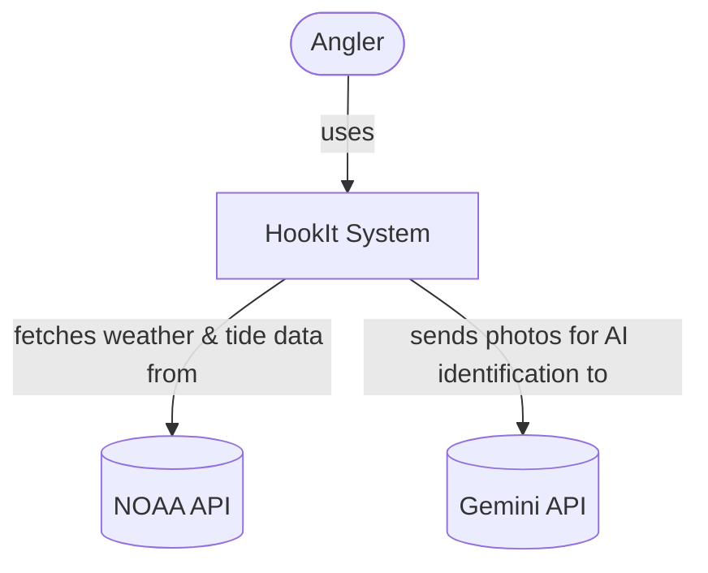
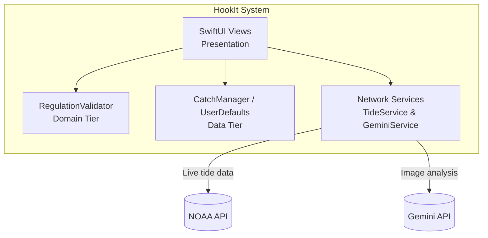
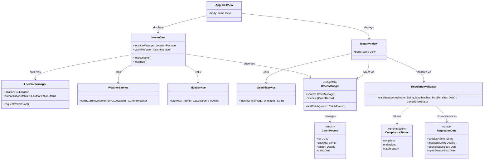
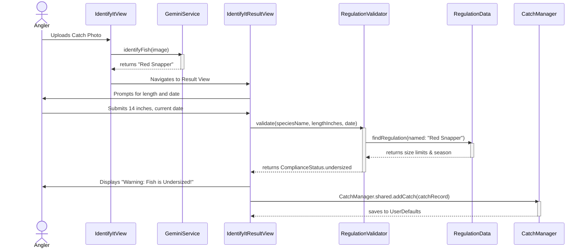

# HookIt

[](https://github.com/ddinza/cen5064-project-dinza/actions/workflows/ci.yml)

<!-- CI badge: after Session 4, replace ORG/REPO and the workflow filename, then uncomment:

-->

**Student:** Dionny Dinza · **Course:** CEN 5064 Software Design, Fall 2026 · **Partner:** [@lfriera92]

## Project 

 HookIt is a native iOS application designed for recreational anglers to digitally log their catches while automatically ensuring compliance with local fishing regulations. To maintain a strict scope and clear architectural tiers, the system focuses on four core features: (1) an AI Fish Identification tool that utilizes the Gemini Vision API to analyze an uploaded photo and identify the species; (2) a Catch Logger where users record their harvest details (species, length, date); (3) a Live Fishing Conditions integration that fetches real-time tide data from the NOAA API based on the user's current GPS coordinates; and (4) a Compliance Engine (Domain Rule) that automatically cross-references every logged catch against the static database to instantly warn the user if a fish is undersized or out of season.

## How to Run

**Prerequisites:** A Mac with Xcode installed.


```bash
1. Clone the Repository

git clone https://github.com/ddinza/cen5064-project-dinza.git
cd cen5064-project-dinza
   
2. Configure API Secrets (Required for Gemini AI Vision)
For security best practices, secrets.plist is excluded from version control via .gitignore. Configure the key using either method below:

Option A: Quick Terminal Setup (Recommended)
Run the following command from the repository root, replacing PASTE_API_KEY_HERE with your Gemini API key (e.g., from Google AI Studio):

cat <<EOF> HookIt/secrets.plist
<?xml version="1.0" encoding="UTF-8"?>
<!DOCTYPE plist PUBLIC "-//Apple//DTD PLIST 1.0//EN" "[http://www.apple.com/DTDs/PropertyList-1.0.dtd](http://www.apple.com/DTDs/PropertyList-1.0.dtd)">
<plist version="1.0">
<dict>
    <key>GEMINI_API_KEY</key>
    <string>PASTE_API_KEY_HERE</string>
</dict>
</plist>
EOF

Option B: Manual File Placement
If using the pre-configured secrets.plist file from the provided USB drive:

Copy secrets.plist.

Place it inside the HookIt folder (in the same directory as HookIt.xcodeproj).

3. Build and Run
Open HookIt.xcodeproj in Xcode.

Select an iPhone Simulator (e.g., iPhone 16 Pro or iPhone 17 Pro Max) from the top destination menu.

Press Cmd + R (or click the Play button) to build and run.

When prompted on initial launch, grant Location permissions so the dashboard can load local fishing conditions.

Testing Note: Location Services & Fishing Conditions
To see the correct local fishing conditions (Weather and Tides), the app must be run on a physical iPhone with active GPS. If you are grading this using the Xcode Simulator, the conditions may be blank when clicking "Enable Location".

```

## Architecture

### Tier breakdown 

| Tier | Responsibilities in THIS system |Example Classes/Modules|
|------|--------------------------------|----------------------------|
| Presentation | Displays the user interface, shows logged catches, collects input for new catches, and alerts the user of regulation violations. |HomeView, AddCatchView, IdentifyItView|
| Service | Orchestrates app workflows, such as handling a new catch photo and securely calling the AI vision integration for identification. |GeminiService, TideService, NOAAResponseDecoder|
| Domain | Defines core fishing entities and enforces the main business rule: validating whether a logged catch violates the static size or season limits for that specific species. |RegulationValidator, ComplianceStatus, FishSpecies|
| Data | Handles the local, on-device storage of user catch history as well as loading the static dataset of fishing regulations. |CatchManager, RegulationData|

### C4 — Context & Container 





### UML Class Diagram



### Sequence Diagram



## Architecture Decision Records

Decisions live in [`docs/adr/`](docs/adr/). Start with ADR-001 in Session 4.

| # | Decision | Status |
|---|----------|--------|
| [001](docs/adr/adr-001.md) | Use Native iOS (Swift/SwiftUI) instead of Cross-Platform | accepted |
| [002](docs/adr/adr-002.md) | Use Local On-Device Database for Catch and Regulation Storage | accepted |
| [003](docs/adr/adr-003.md) | Implement Custom macOS CI Pipeline via GitHub Actions | accepted |
| [004](docs/adr/adr-004.md) | Insert Your ADR-004 Title Here | accepted |

## Weekly log 

A one-line note per week keeps your commit story readable:

- Week 1 (Aug 24): repo created, HookIt core architecture and AI Vision integration drafted
- Week 2 (Aug 31): implemented local offline services, regulations data provider, and domain-tier validation rule
- Week 3 (Sep 7): finalized 4-feature scope constraint, integrated compliance engine alerts into catch logging, and resolved UI layout alignments
- Week 4-5 (Sep/Oct): Implemented NOAAResponseDecoder and live URLSession network fetches for real-time tide data.
- Week 6 (Oct): Refactored UI to remove glassmorphism, restoring solid cards and SF Symbols for conference day presentation.
- Week 7 (Oct): Added CI pipeline for macOS runner to automate Xcode builds and ensure repository stability.
- Week 8 (Nov): Addressed midterm feedback by fixing date parameters in season validation, configuring the GitHub Project board, and aligning N-Tier, C4, and UML design documentation with the Swift codebase.
